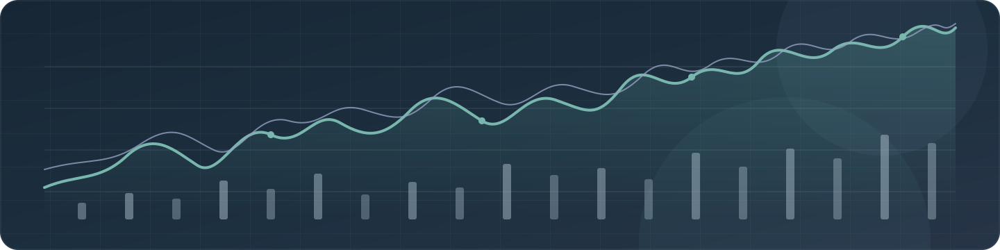

<div align="center">



<h1>Bitcoin Market Intelligence</h1>

<h3>Risk-first exploration of historical BTC market data.</h3>

<br>

[](https://www.python.org/)
[](https://streamlit.io/)
[](https://parquet.apache.org/)
[](LICENSE)
[](tests/)

<br>

<p><em>Research-led analytics. Historical data only — not financial advice.</em></p>

</div>

---

## Focus

This project emphasizes **higher-signal analysis**: volatility/risk, regimes, anomaly/change-point diagnostics, and benchmarked evaluation. Short-horizon BTC return forecasts are noisy; naive and regularized-linear baselines plus walk-forward stability checks are first-class comparisons. **sMAPE is treated as diagnostic only** for near-zero returns.

> No live feeds, trade execution, or trading signals.

## What’s included

| Area | Details |
|:--|:--|
| **Forecast evaluation** | Naive and ridge/linear baselines, ARIMA as benchmark-only, LightGBM/CatBoost; metrics include MAE/RMSE, direction accuracy, correlation/IC, MASE, naive-scaled MAE (DM where computed). Walk-forward/expanding evaluation utilities in `src/models/rolling_validator.py`, exported by notebooks when run. |
| **Volatility/risk** | Rolling/realized-vol proxies and conditional volatility (GARCH with Student-t in config) compared with QLIKE/MAE where available. |
| **Regimes** | GMM/HMM with diagnostics (log-likelihood/BIC, state shares, persistence/switches) — exploratory, not ground truth. |
| **Anomalies & breaks** | Isolation Forest scores with threshold sensitivity/context; CUSUM change-points with local pre/post summaries; Matrix Profile motif/discord export when generated. |
| **Dashboard** | Streamlit `Home.py` + `pages/` (Data Lab, Forecasting replay/diagnostics, Volatility, Regimes, Anomalies, Change Points) reading local `processed/` and `artifacts/` exports. |

## Pipeline

Run notebooks in order: `01_data_pipeline` → `02_feature_engineering` → `03_modelling` → `04_evaluation_and_export`.

- Notebook 03: baselines + walk-forward checks, tree models, GARCH (Student-t) vs realized-vol proxy, regimes/anomalies/change-points/matrix-profile diagnostics and exports.
- Notebook 04: consolidated metrics, naive/linear comparison, residual diagnostics, experiment logging, artifact readiness.

Helper: `python scripts/prepare_data.py [--full] [--no-notebooks]` (research deps required; full Spark pipeline needs compatible Java per `configs/pipeline.yaml`).

## Quick start

```bash
python -m venv .venv
# Windows: .\.venv\Scripts\Activate.ps1  |  macOS/Linux: source .venv/bin/activate
python -m pip install -r requirements.txt
streamlit run Home.py
```

Full reproduction: `python -m pip install -r requirements-research.txt` then run notebooks 01→04.

> **Data/artifacts not bundled.** Generate/provision `processed/` and `artifacts/` locally (git-ignored). Treat exported joblib/pickle artifacts as trusted.

## Responsible use

Exploratory, assumption-sensitive outputs; no guarantee of future behavior. **Not investment, trading, or financial advice.**

## License

[MIT](LICENSE)
