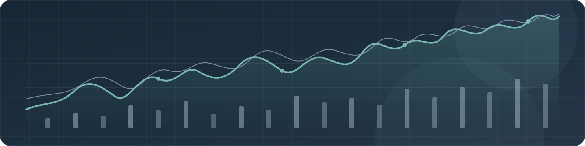
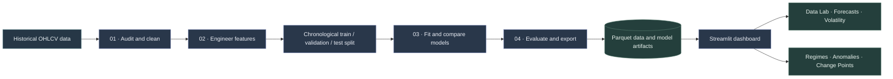
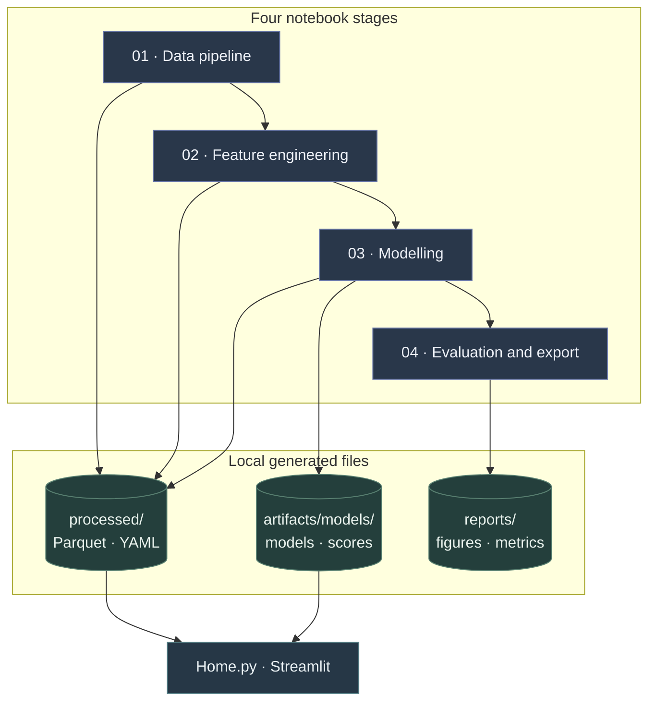

<div align="center">



<h1>Bitcoin Market Intelligence</h1>

<h3>Explore the patterns behind historical BTC market data.</h3>

<a href="https://readme-typing-svg.demolab.com"></a>

<br>

[](https://www.python.org/)
[](https://streamlit.io/)
[](https://parquet.apache.org/)
[](LICENSE)

<br>

<p><em>Research-led market analytics. Historical data only — not financial advice.</em></p>

</div>

---

## At a glance

Bitcoin time series can tell a richer story than price alone. This personal research project combines data preparation, feature engineering, statistical and machine-learning experiments, and an interactive dashboard for exploring historical market behavior.

> **Built for exploration, not execution.** There are no live market feeds, trade execution features, or trading signals.

| Explore | What you can investigate |
|:--|:--|
| **Market structure** | Price, volume, returns, feature relationships, and rolling risk |
| **Forecasts** | Replay saved models over a selected historical window |
| **Market regimes** | Explore Gaussian Mixture Model (GMM) and Hidden Markov Model (HMM) states |
| **Anomalies** | Review exported Isolation Forest scores and anomaly thresholds |
| **Change Points** | Visualize exported structural breaks alongside volatility |
| **Research workflow** | Audit data, engineer features, split chronologically, evaluate, and export artifacts |

<div align="center">

**A consistent analysis loop** &nbsp; · &nbsp; *from raw observations to interactive exploration*

</div>



## Dashboard

The root-level Streamlit app provides shared dataset, date-range, and bar-resolution filters, a chart-detail control, and a light/dark theme toggle. Each analysis page uses the selected dataset and date window. Streamlit discovers the pages from the root `pages/` directory. Aggregation is useful for visual exploration, but it changes feature and target values; forecasting replay is therefore available only with **Raw** bars.

| Page | What it provides |
|:--|:--|
| **Home** | Price/volume charts, market-window metrics, return texture, rolling risk, and monthly returns; volatility is bar-based and not annualized |
| **Data Lab** | Search and filter features; inspect timelines, distributions, normalized comparisons, correlations, and data quality; preview or export the filtered data |
| **Forecasting** | Replay a saved LightGBM or CatBoost model against the configured target on raw bars; this is historical replay, not a forward forecast or holdout evaluation |
| **Volatility** | Explore rolling volatility, exported GARCH estimates, and window drawdown |
| **Regimes** | Apply saved GMM/HMM models to the selected feature history and inspect inferred states and HMM transition probabilities |
| **Anomalies** | Explore exported Isolation Forest scores and adjust the flagged-score percentile for the selected window |
| **Change Points** | View exported CUSUM timestamps alongside price and volatility |

> [!NOTE]
> **Data and artifacts are not bundled.** The dashboard reads local prepared Parquet files from `processed/` and optional model/score exports from `artifacts/`. These generated files are git-ignored and are not downloaded automatically. Provide the Parquet files and any desired artifacts separately when deploying. Pages that need an absent model or export explain which notebook output to generate.

The shared chart-detail control caps plotted samples for responsiveness; summary metrics, filters, and data exports use the full selected rows. The Data Lab CSV export is prepared only when requested. Forecasting requires the raw feature dataset and matching `processed/split_meta.yaml`; exported model artifacts must be trusted because loading joblib/pickle files can execute code.

## Research pipeline



### Notebook sequence

| Notebook | Responsibility | Main outputs |
|:--|:--|:--|
| [`01_data_pipeline.ipynb`](notebooks/01_data_pipeline.ipynb) | Audit, ingest, standardize timestamps, clean, profile | `btc_cleaned.parquet`, audit metadata, exploratory figures |
| [`02_feature_engineering.ipynb`](notebooks/02_feature_engineering.ipynb) | Build features and chronological partitions | `btc_features.parquet`, train/validation/test Parquet, split metadata |
| [`03_modelling.ipynb`](notebooks/03_modelling.ipynb) | Fit forecasting, regime, anomaly, and change-point models | Model artifacts, scores, draft metrics |
| [`04_evaluation_and_export.ipynb`](notebooks/04_evaluation_and_export.ipynb) | Compare results and check dashboard deliverables | Forecast metrics, experiment log, artifact checklist |

Notebook cell outputs are cleared in the repository to keep source files small. Run the notebooks to regenerate their outputs and project artifacts.

## Get started

### 1 · Set up Python

Use Python **3.10 or newer**. From the repository root, create and activate a virtual environment, then install the dashboard dependencies:

```bash
python -m venv .venv
# Windows PowerShell
.\.venv\Scripts\Activate.ps1
# macOS / Linux: source .venv/bin/activate
python -m pip install --upgrade pip
python -m pip install -r requirements.txt
```

`requirements.txt` contains minimum supported versions rather than a fully locked environment.

The dashboard requires at least one prepared Parquet file in `processed/` with a recognizable timestamp column. Model pages also use the matching saved models, scalers, or CSV exports when those are available.

### 2 · Prepare the data and research environment

To reproduce the research pipeline, install the larger research environment. It includes the dashboard requirements and additional data-ingestion, modeling, and notebook packages:

```bash
python -m pip install -r requirements-research.txt
jupyter notebook notebooks/
```

Run the notebooks in order: **01 → 02 → 03 → 04**. Dataset access requires an internet connection. The Spark-backed pipeline requires a compatible Java runtime; configure the local Java path in [`configs/pipeline.yaml`](configs/pipeline.yaml) for your machine before running it. The standard notebook run focuses on the core statistical, tree-model, regime, and anomaly workflows; optional deep-learning wrappers remain separate. Install their larger dependencies only when needed with `python -m pip install -r requirements-deep-learning.txt`.

### 3 · Launch the dashboard

```bash
streamlit run Home.py
```

For Streamlit Community Cloud, choose the repository and set **Main file path** to `Home.py`. Provision the required Parquet data and any optional model artifacts through your deployment/storage process. The app does not fetch these files automatically; do not commit large datasets, serialized models, or private credentials just to make them available. See the [deployment guide](DEPLOYMENT.md) for details.

## Data sources

The pipeline configuration identifies these Hugging Face datasets:

| Dataset | Configured split | Intended use |
|:--|:--|:--|
| [`WinkingFace/CryptoLM-Bitcoin-BTC-USDT`](https://huggingface.co/datasets/WinkingFace/CryptoLM-Bitcoin-BTC-USDT) | `train` | Primary BTC-USDT time series |
| [`lanasx3/crypto-market-datasets`](https://huggingface.co/datasets/lanasx3/crypto-market-datasets) | `train`, `klines_spot` | Secondary spot OHLCV data |

The notebook pipeline is configured to read these sources; the dashboard itself uses the prepared local Parquet outputs. Dataset availability, licensing, schema, and remote access policies can change. Check each source’s terms before use or redistribution.

## Technology

| Layer | Selected tools |
|:--|:--|
| Data and processing | Hugging Face `datasets` · PySpark · pandas · Parquet |
| Feature engineering | Returns · volume · volatility · market structure |
| Forecasting and analysis | LightGBM · CatBoost · ARIMA · GARCH · GMM · HMM |
| Anomaly and structural analysis | Isolation Forest · Matrix Profile · CUSUM |
| Interactive visualization | Streamlit · Plotly |
| Experiment tracking | MLflow |

TCN and PatchTST wrappers exist in the research code, but notebook deep-learning training is optional/stubbed. Their dependencies are isolated in [`requirements-deep-learning.txt`](requirements-deep-learning.txt); these models are not trained or available in the dashboard.

## Evaluation & experiment design

Forecasting experiments use a **chronological split** rather than random shuffling, keeping later observations out of the training period. Trailing rows are purged from train and validation so forward target labels do not cross partition boundaries. Annualized volatility uses the observed bar interval from the data audit. The default configuration uses a one-bar-ahead log-return target and a 70 / 15 / 15 train–validation–test split.

| Experiment choice | Project default |
|:--|:--|
| Forecast target | `target_log_return_1` |
| Target horizon | 1 bar ahead |
| Data partitions | 70% train · 15% validation · 15% test |
| Feature windows | 7, 14, 30, and 60 bars |
| Return lags | 1, 2, 3, 5, and 10 bars |
| Forecast metrics | MAE · RMSE · sMAPE |

Baseline and ARIMA forecasts are compared with LightGBM and CatBoost. Regime, anomaly, and change-point experiments are analyzed separately from the forecast metrics. Configuration defaults live in [`configs/pipeline.yaml`](configs/pipeline.yaml); logged experiment results are recorded in [`configs/experiments.yaml`](configs/experiments.yaml).

> [!IMPORTANT]
> Return targets are often close to zero. **sMAPE can become sensitive around small denominators**, so interpret it alongside MAE and RMSE rather than using it as the sole model-selection measure.

## Reproducibility & generated files

The notebooks are kept free of saved outputs so they remain lightweight and contain the reproducible source rather than stale rendered results. Run the four stages in order to regenerate the datasets, metrics, and model artifacts used by the dashboard.

| Generated output | Used for |
|:--|:--|
| Prepared Parquet and YAML in `processed/` | Dashboard datasets, chronological splits, and pipeline metadata |
| Model files and exported scores in `artifacts/` | Forecasting, regime, volatility, and anomaly pages |
| Figures and metric reports in `reports/` | Research outputs and model comparisons |

These output directories are git-ignored because generated data and visualizations can be large. For hosted use, provision the required Parquet data and any desired model artifacts through an appropriate storage or deployment process instead of committing them to the repository.

## Responsible use

> Historical relationships do not guarantee future behavior. Forecasts, regimes, volatility estimates, and anomaly scores are exploratory outputs; they may be incomplete, sensitive to assumptions, or unsuitable for decisions without independent validation.

<ins>Nothing in this repository is investment, trading, or financial advice.</ins>

## Project guides

- [Deployment guide](DEPLOYMENT.md) — hosting, data/artifact provisioning, and secrets

## License

Released under the [MIT License](LICENSE).

<div align="center">

<sub>Built for curious, careful exploration of historical markets.</sub>

</div>
